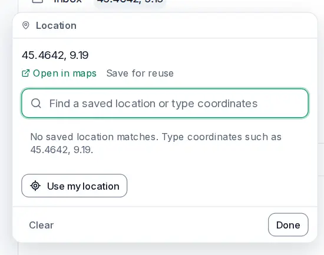

# Locations

<picture><source srcset="images/locations-dark.webp" media="(prefers-color-scheme: dark)"></picture>

A task can say where it happens: the post office, a client's address, the parcel locker. The location shows on the task panel's **Where** line, with a small map and **Open in maps**.

## Set a location

Open a task and choose its location on the **Where** line, or **Add → Location**. In the field you can:

- type an address and pick a result (when maps are on);
- type coordinates such as `45.4642, 9.19` and choose **Use 45.4642, 9.19**;
- pick one of your saved locations.

**Use my location** asks the browser for your position. **Pick on the map** lets you click a point. With maps on, both fill in the nearest address. **Clear** removes the location. Every change is one edit that **Undo** takes back, and it works offline except the address search.

**Open in maps** opens your phone's maps app, or the position on openstreetmap.org on a computer.

## Saved locations

**Save for reuse** keeps a task's location under a name such as *Office*. A task linked to a saved location follows it: rename the location or move its pin, and every linked task shows the change. Delete it, and the tasks keep the address they had.

**Locations**, in the sidebar's **More** group, lists your saved locations with their open tasks and a map of all of them. Open one to see its tasks as a list; a task you add there gets that location. Rename, reorder or delete a location from its menu. Saved locations are yours alone; they are never shared.

## Maps and privacy

Maps use OpenStreetMap data. Tiles and address searches come from the provider your server uses (OpenFreeMap and Photon by default) through your server, so the provider sees your server, the area shown and what you type into the search, never your account, your tasks or your own address.

To turn maps off on all your devices, switch off **Settings → General → Maps**. Locations keep working with coordinates and **Open in maps**. The server owner can turn maps off for everyone; see [Maps](self-hosting/maps.md).

With [end-to-end encryption](e2ee.md), locations and saved locations are encrypted like task titles. A device that is locked shows *Encrypted* and no map.
