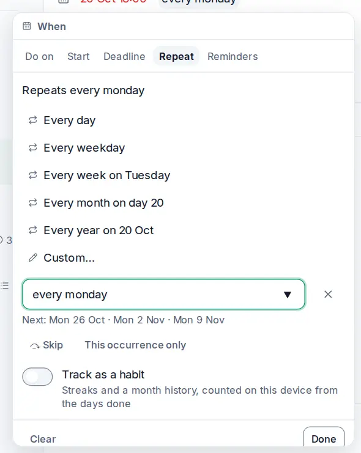

# Recurring tasks and reminders

<picture><source srcset="images/repeat-dark.webp" media="(prefers-color-scheme: dark)"></picture>

Some tasks come back: pay the rent, water the plants, the weekly one-to-one. Make them repeat once and OpenTodo moves them forward each time you complete them. Add a reminder and you'll get a nudge when it matters.

## Make a task repeat

Open the task, click its date and choose **Repeat**: pick **Every day**, **Every weekday**, **Every week on Thursday**, **Every month on day 22** or **Every year**, named from the task's date. **Custom…** takes any rule, such as `every 3 months`, and shows the next three dates so you can check it does what you meant.

Set a rule in the task panel under **Repeat**, or type it straight into quick add: `Water plants every Monday` creates the task with the rule and its first date. See [Repeat and remind](quick-add.md#repeat-and-remind) for the phrases in each language.

Repeating tasks show a ↻ symbol on the row. To stop repeating, select the **×** next to the rule.

## Rules you can write

`every day`, `every weekday`, `every 2 weeks`, `every 3 months`, `every mon, wed, fri`, `every 15th`, `every last friday`, `every 2nd tuesday` and `every year` all work. Add `after completion` to count from the day you finish, and `until 2026-12-31` or `for 10 times` to end the series. Rules are in English. See [Repeat rules](repeat-rules.md#rules-you-can-write) for the full list and the [recurring task rules](recurrence.md) reference for every detail.

## Complete, skip or split off one occurrence

Completing a repeating task records that occurrence and moves the task to its next date. **Skip** (<kbd>Shift</kbd>+<kbd>S</kbd>) moves on without recording a completion; **This occurrence only** (<kbd>Shift</kbd>+<kbd>O</kbd>) splits the current occurrence off as a normal task while the series moves on. See [Repeat rules](repeat-rules.md#complete-skip-or-split-off-one-occurrence).

## Track a habit

Turn on **Track as a habit** under **Repeat** (for rules like `every day`, not `after completion`). The row shows a flame chip with your streak; the task panel shows your best streak and a month grid of done, skipped and missed days, counted on your device.

**Skip** keeps the chain without adding to it; a scheduled day that passes undone breaks it. A daily habit due Monday and completed Wednesday misses Tuesday and Wednesday. Save the query `habit` as a view to list your habits. See [Habits](recurrence.md#habits).

## Add a reminder

Open a task and select **+ Add reminder** under **Reminders**: at the due time, a set time before or after it, relative to the deadline, or at a fixed date and time. A task can have several reminders, and relative ones move with the due date. See [Task reminders](task-reminders.md#add-a-reminder).

## When a reminder goes off

While OpenTodo is open, a reminder pops up in the corner of the screen with snooze and dismiss buttons, without a connection and without any permission. To get reminders when the app is closed, turn on notifications for each device in **Settings → Notifications**. See [Task reminders](task-reminders.md#when-a-reminder-goes-off).

## Shared projects

Reminders are personal. On a task in a shared project, your reminders are yours alone: other members don't see them and don't get them. You can add reminders even if you can only view the project.

## Tips

- For bills, use a day-of-month rule (`every 1st`) plus a **1 day before** reminder.
- A reminder on a task without a time fires at 09:00 for "at due time". Give the task a time if you need it earlier.
- Deleted tasks don't remind you. If you restore one, its reminders come back.
