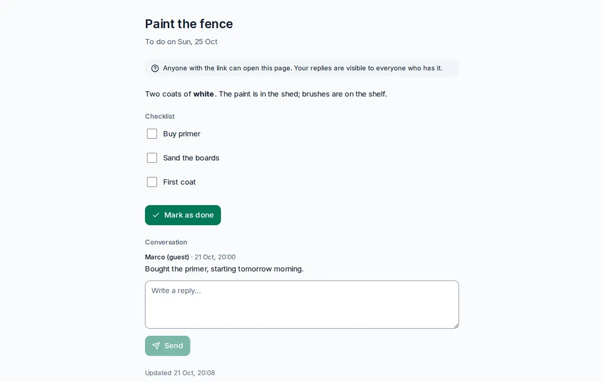

# Task pages

<picture><source srcset="images/task-page-dark.webp" media="(prefers-color-scheme: dark)"></picture>

A task page hands one task to someone who has no account: a friend helping with the garden, a colleague, a neighbour. They open a link and see the task as a calm page: its title, dates, description, checklist, links, the map if it has a location, and the conversation. Depending on what you allow, they can reply and tick.

## Publish a task

Open the task, then **Publish task page…** in the panel's menu (the **⋯** button). Choose what guests can do:

- **Read**: the page only.
- **Reply**: they can also write replies.
- **Reply and tick**: they can also tick subtasks and mark the task done (or reopen it within a day).

Add a label if you like (it is shown after the link's secret and says what the page is about), an expiry, and whether to show the map. Then **Publish**. The link is shown once: copy it and send it. Anyone with the link can open the page, so share it like a key.

A task can have one page. While it has one, the panel's header says **Published**: open it to see when the page was last opened and how many replies it got, to **Copy a new link** (the old one stops working) or to **Revoke** it. Only the task's owner, or the owner and admins of its shared project, can publish. Subtasks are shown on their parent's page, not published on their own. Publishing needs a connection.

## What guests see and do

The page needs no account and sets no cookie; it is not indexed by search engines and sends no referrer. It refreshes every 30 seconds. Guests type their name once; it is kept only in their browser, and their replies read "Marco (guest)" in the task's comments, with a mark that they came through the page. History and activity name them as "Marco (guest, task page)". You get a notification for each reply and when a guest marks the task done.

Only comments written after you published appear on the page, and the comment box says so while the task is published. Guests cannot see the project, labels, notes, assignees or anyone's email.

## Encrypted tasks

With [end-to-end encryption](e2ee.md), the server cannot read your task, so your device publishes it differently: it creates a key for this page only, encrypts a copy of the page with it, and adds the key to the link after `#`. Browsers never send that part, so the server never sees it. The guest's browser opens the page with it; a link without that part shows nothing.

Replies from guests are encrypted with the same key and wait on the server until one of your unlocked devices imports them as comments. When you change the task, your device updates the page's copy within a minute of syncing. Files are not shown on encrypted pages, only links.

## Limits

An account can have 100 active pages and publish 20 an hour. A page takes 20 replies an hour and 60 ticks a minute. Revoking deletes the page's copy and any replies still waiting.

See also [Public links](public-links.md) to share a whole project, and [Sharing](sharing.md).
