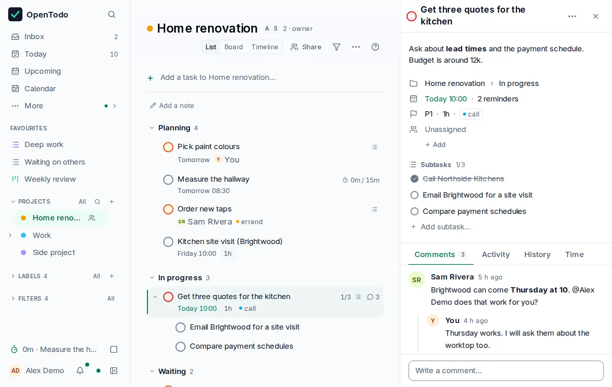

# The task panel

<picture><source srcset="images/task-detail-dark.webp" media="(prefers-color-scheme: dark)"></picture>

Select a task with <kbd>j</kbd> / <kbd>k</kbd> and press <kbd>Enter</kbd> to open its panel; a click edits the title in place, and its arrow (or <kbd>Shift</kbd>+<kbd>Enter</kbd>) opens the panel. Every change is saved as you make it; there is no Save button. Click empty space or press <kbd>Esc</kbd> to let go.

## The top of the panel

The top of the panel stays in view while you scroll: the task's **checkbox**, its **title** (edit it in place; a long one wraps onto two lines), a **⋯** menu with **Copy link**, **Expand**, **Attach**, **Delete** and the less frequent actions, and the **×** that closes it. Below is **Notes**: one quiet line until you click it, then an editor (see [Write notes](notes-and-subtasks.md#write-notes)). Long notes show about eight lines and **Show all**.

## The four lines

Then come the task's properties as four short lines, in the words the list uses:

- **Where**: the project, then the section (`Work › Doing`), "under" the parent for a subtask, and where the task came from.
- **When**: the date and time ("Tomorrow 09:00"), then evening, the repeat rule, the deadline, the start ("from" or "since") and the reminders. "Not scheduled" when there is none.
- **How**: the priority, the estimate and the labels.
- **Who**, when set: the assignee, what the task waits for, and how many tasks wait for it.

Click a part, or <kbd>Tab</kbd> to it and press <kbd>Enter</kbd>, to open its editor next to it; click it again or press <kbd>Esc</kbd> to close it. Every editor has **Clear** and **Done**. The **When** editor shows one part at a time (**Do on**, **Start**, **Deadline**, **Repeat**, **Reminders**), starting with the one you clicked; **This Evening** and the time zone are in **Do on**. To set something that isn't shown, open **Add**: it lists the rest under Where, When, How and Who with their shortcuts, and **Choose files…** and **Add a link…** to attach. Press <kbd>1</kbd> to <kbd>4</kbd> anywhere in the panel for the priority. See [Dates and times](dates-and-times.md), [Deadlines and start dates](deadlines-and-start-dates.md) and [Assign tasks](sharing.md#assign-tasks).

Below the lines: subtasks, attachments and the Comments, Activity and History tabs, described in [Notes, subtasks and dependencies](notes-and-subtasks.md), and **Time**, the task's time entries (see [Time tracking](time-tracking.md)). The tabs stay in view while you read a long thread.

## Viewers

If you are a viewer of a shared project, the lines read as text and can't be changed, and the checkbox and **Delete** are disabled. You can still comment.

## Close the panel

Close the panel with <kbd>Esc</kbd> or the **×** at the top. On a phone the panel covers the list; close it to go back.
